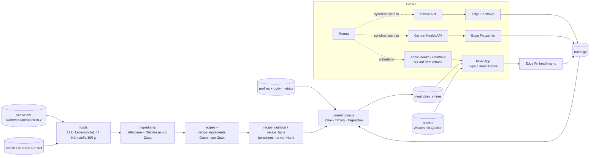

# Fiber – Architektur und Informationsfluss

## Grundsatz
Fiber trifft keine Ernährungsaussage ohne Quelle. Jede Zahl lässt sich auf eine offizielle Datenbank, eine Formel oder eine Leitlinie zurückführen (siehe `core/engine.js → SOURCES` und den Artikel „So rechnet Fiber“).

## Datenfluss



## Bausteine

| Ordner | Inhalt |
|---|---|
| `data/foods-ch.json` | Komplette Schweizer Nährwertdatenbank (BLV, Stand 07/2026), 1216 Lebensmittel |
| `data/foods-usda.json` | 15 Ergänzungen aus USDA SR Legacy (nur wo BLV keinen Eintrag hat) |
| `data/ingredients.js` | 134 Zutaten → Lebensmittel, Allergene (14 Hauptallergene), Diätklasse, Tauschregeln |
| `data/recipes.js` | 58 Rezepte in Gramm, Zubereitung, Fotos |
| `data/knowledge.js` | 15 Wissensartikel mit Quellen, Zuordnung der Info-Buttons |
| `core/engine.js` | Nährwert-Engine (Browser, Node, Deno). Einzige Stelle mit Berechnungslogik |
| `tests/engine.test.js` | 13 Tests: Formeln, Datenintegrität, Atwater-Plausibilität, Allergene, Planer |
| `supabase/migrations` | Schema, Views, Row Level Security |
| `supabase/seed.sql` | Generiert mit `npm run build:data` |
| `supabase/functions` | `plan-day`, `strava`, `garmin`, `health-sync` |
| `scripts/validate-db.mjs` | Spielt Schema + Seed in Postgres (PGlite) ein und testet RLS |

## Wie präzise ist was?

| Grösse | Methode | Typische Abweichung |
|---|---|---|
| Nährwerte pro Lebensmittel | BLV-Analysewerte; geschätzte Werte sind markiert (`estimated`) | natürliche Schwankung ±10–20 % |
| Nährwerte pro Rezept | Summe der Zutaten (roh/trocken gewogen) | Garverluste bei Vitaminen nicht modelliert |
| Ruheumsatz | Mifflin-St Jeor bzw. Katch-McArdle | ±10 % bei 80 % der Personen |
| Trainingsverbrauch | Gerätemessung, sonst MET (Compendium 2024) | MET ±15–25 % |
| Zielanpassung | Gewichtstrend vs. Prognose nach 2–3 Wochen (geplant) | korrigiert systematische Fehler |

## Integrationen – Stand

| Anbieter | Weg | Stand |
|---|---|---|
| **Strava** | OAuth 2 + Webhook, Aktivitäten inkl. Kalorien | Code fertig (`functions/strava`). Benötigt Strava-API-App und Secrets |
| **Garmin** | Garmin Health API (Push) | Code fertig (`functions/garmin`). Benötigt Zulassung im Garmin Connect Developer Program (Bewerbung, Prüfung durch Garmin) |
| **Apple Health** | HealthKit lokal auf dem iPhone, Upload an `health-sync` | Server fertig. App-Teil braucht die native Expo-App (`react-native-health`); im Web-Prototyp simuliert |
| **Runna** | Keine öffentliche API bekannt. Runna synchronisiert Läufe zu Strava, Garmin und Apple Health – Fiber erkennt diese Läufe und markiert sie als Runna | Funktioniert über die drei Wege oben. Für **geplante** Runna-Einheiten (Vorab-Tipps) ist eine Partnerschaft mit Runna nötig |

## Qualität und Sicherheit
- **Fachliche Freigabe:** Rezepte und Artikel haben einen Review-Status. Redaktionelle Inhalte erscheinen erst nach Freigabe durch eine Ernährungsberaterin oder einen Ernährungsberater (BSc, SVDE) – im Datenbankschema erzwungen.
- **Allergene:** pro Zutat, 14 Hauptallergene nach LIV Anhang 6; Spuren und Kreuzkontaminationen kann Fiber nicht kennen (Hinweis in der App).
- **Schutzregeln:** kein Defizit unter 18, bei BMI < 18.5, in Schwangerschaft und Stillzeit oder nach Essstörung; Defizit max. 25 %, nie unter dem Ruheumsatz.
- **Datenschutz:** Gesundheitsdaten sind besonders schützenswert (revDSG Art. 5, DSGVO Art. 9). Supabase-Projekt in der Region EU (Frankfurt) oder Schweiz, ausdrückliche Einwilligung (`consent_health_data_at`), Konto-Löschung löscht alle Daten (`delete_my_account`). OAuth-Tokens sind für Clients unlesbar.
- **Regulierung:** Fiber gibt allgemeine Ernährungsempfehlungen für gesunde Erwachsene und ist kein Medizinprodukt. Funktionen zur Behandlung von Krankheiten (z. B. Diabetes-Dosierung) würden das ändern und sind bewusst ausgeschlossen.

## Lokale Entwicklung
```bash
npm install
npm test               # Engine + Datenintegrität
npm run build:data     # seed.sql + Engine-Kopie für Edge Functions
npm run validate:db    # Schema, Seed und RLS in Postgres prüfen
supabase start && supabase db reset   # mit Supabase CLI
```

## Nächste Schritte
1. Fachliche Prüfung aller Rezepte und Artikel durch SVDE-Fachperson.
2. Expo-App aufsetzen (iOS zuerst wegen HealthKit), Logik aus `core/engine.js` übernehmen.
3. Strava-API-App registrieren, Garmin-Developer-Antrag stellen, Runna wegen Partnerschaft anfragen.
4. Adaptive Zielanpassung: Energiebedarf aus Gewichtstrend und erfasster Zufuhr nachschätzen.
5. Barcode-Scan (Open Food Facts) für verpackte Produkte, mit klarer Kennzeichnung der Datenqualität.
